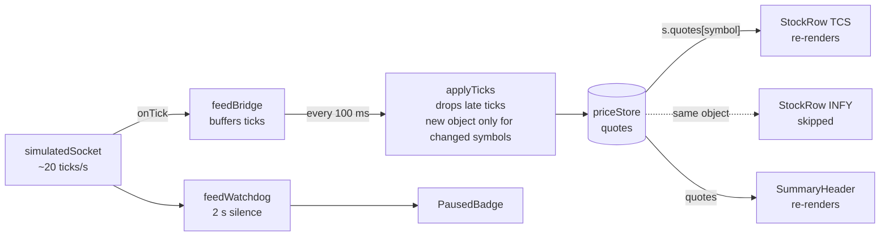

# Live Portfolio

A stock portfolio app in React Native (Expo, TypeScript). Prices come from the Liquide OHLC API, and a simulated feed ticks them live about 20 times a second. It has three screens (Portfolio, Watchlist, Stock detail) and a Buy/Sell sheet.

**Tested on: Android** (Android emulator, through Expo Go). iOS was not tested; nothing in the code is Android-specific.

## Install and run

### Requirements

| Tool | Version | Setup |
|---|---|---|
| Node.js | 20 or newer (built with 24) | [nodejs.org](https://nodejs.org/) |
| npm | comes with Node | — |
| Expo CLI | none to install, runs through `npx expo` | [Expo docs](https://docs.expo.dev/get-started/set-up-your-environment/) |
| Expo Go | the build for **SDK 58** | [expo.dev/go](https://expo.dev/go) |
| Android emulator *(what I tested)* | Android Studio with a virtual device | [Expo: Android Studio emulator](https://docs.expo.dev/workflow/android-studio-emulator/) |
| iOS simulator *(optional, macOS only)* | Xcode | [Expo: iOS Simulator](https://docs.expo.dev/workflow/ios-simulator/) |

You need **one** of these to run the app: an Android emulator, an iOS simulator, or a real phone with Expo Go installed. Expo Go installs itself on an emulator or simulator the first time you run the app.

### Steps

```bash
git clone https://github.com/kishan-ghetia/live-portfolio.git
cd live-portfolio
npm install
```

Then pick one way to open it:

```bash
npx expo start --android   # Android emulator (start it in Android Studio first), what I tested
npx expo start --ios       # iOS simulator (macOS only)
npx expo start             # QR code: scan it with Expo Go on a real phone (same Wi-Fi)
```

While Metro is running you can also press `a` (Android) or `i` (iOS) in the terminal, and `r` to reload.

### Tests and type check

```bash
npm test             # 60 unit tests across 15 suites
npm run typecheck    # tsc --noEmit (strict mode, no `any`)
```

## Architecture: MVVM

- **Model:** `store/`, `api/`, `feed/` and `utils/` hold the data, the live feed and the maths.
- **ViewModel:** one hook per screen (`hooks/use…ViewModel.ts`) gets the data ready and owns the screen's state and actions.
- **View:** `screens/` and `components/` only render what the ViewModel returns.

```
src/
  api/         HTTP client + OHLC request and parser (zod-validated, rupees → paise)
  feed/        PriceSocket interface, simulatedSocket, feedBridge (batching), feedWatchdog (paused state)
  store/       Zustand stores: prices, portfolio, watchlist (persisted)
  hooks/       ViewModels: one per screen, the only place screens get data from
  components/  StockRow, SummaryHeader, TickChart, PausedBadge; ui/ holds the base Text, Button, Input, Card, Pills, StateView
  screens/     Portfolio, Watchlist, StockDetail, TradeSheet
  utils/       Pure, unit-tested logic: pnl, money formatting, trade, sorting, chart shape, CSV parsing
  data/        Bundled starting holdings (the CSV from the brief, OLDCO included)
```

Base UI components (`components/ui/`: `AppText`, `AppButton`, `AppTextInput`, `Card`, `Pills`, `StateView`) were built only where the screens needed them, to fit the timeline, not as a full design system.

**Swapping in a real feed.** Any client that implements the `PriceSocket` interface in `feed/priceSocket.ts` (`connect()`, `disconnect()`, `onTick()`) can replace `simulatedSocket` in `feed/liveFeed.ts`:

```ts
// const socket = createSimulatedSocket(() => usePriceStore.getState().quotes);
const socket = createRealSocket(); // implements PriceSocket
```

## State and re-render approach

**Choice: Zustand, with narrow selectors.** Every component subscribes to exactly the slice it renders, so a price change re-renders only the components that show that price.

- **Over Context:** Context re-renders every consumer on any change.
- **Over Redux:** Zustand gives the same selector model with far less boilerplate.

How a tick reaches the screen:




1. **The socket emits** a partial tick: `{ symbol, seq, ltp?, high?, low?, volume? }`. ([simulatedSocket.ts](src/feed/simulatedSocket.ts))
2. **`feedBridge` buffers ticks** and flushes them every 100 ms in a single store update. That gives roughly 10 commits per second instead of 20. ([feedBridge.ts](src/feed/feedBridge.ts))
3. **`applyTicks`** (a pure function with tests) drops late ticks (`tick.seq <= quote.seq`). Only symbols that actually changed get a new object, so everything else keeps the same reference. ([applyTick.ts](src/feed/applyTick.ts))
4. **Each `StockRow` is `memo`'d** and selects its own quote (`s.quotes[symbol]`) and holding. A tick for TCS re-renders only the TCS row. ([StockRow.tsx](src/components/StockRow.tsx))
5. **The list ViewModel returns only symbols.** Sorting uses a snapshot of prices taken when you change the sort order, so the list doesn't reorder or re-render on every tick. `FlatList` uses `getItemLayout`, and its `keyExtractor` and `renderItem` are stable functions. ([usePortfolioViewModel.ts](src/hooks/usePortfolioViewModel.ts))
6. **Stock detail is split** into `PriceHeader`, `TickChart` and `Position`, and each one subscribes for itself. The screen component itself never re-renders on ticks. ([StockDetailScreen.tsx](src/screens/StockDetailScreen.tsx))
7. **Hidden screens are frozen.** `freezeOnBlur` is on for both navigators, so screens you can't see don't render. ([RootNavigator.tsx](src/navigation/RootNavigator.tsx))

**Paused indicator.** `feedWatchdog` flips `feedStatus` to `paused` after 2 seconds with no ticks. `PausedBadge` sits in every screen header and selects only that flag.

## Money and rounding

- **Every amount is integer paise.** API prices and average prices go through `toPaise` (`Math.round(rupees × 100)`) at the boundary. The simulator also rounds each new ltp to whole paise.
- **Totals reconcile exactly.** Row value is `qty × ltp`, and P&L is `value − invested`. Both are integers, so they're exact. The Summary adds up those same integer row values. Since the screen shows two decimals (whole paise), **the Summary totals always equal the sum of the rows as displayed**.
- **Percentages are not summed.** They're always worked out from the summed paise totals, for example total P&L % = total P&L ÷ total invested.
- **There's one deliberate rounding step: a sell.** The quantity drops, the average price stays the same, and the remaining cost is `Math.round(invested × remaining ÷ qty)`. That rounds once, to whole paise. A buy is exact: invested goes up by `qty × fill price`, and the new average is invested ÷ qty.
  - *Example:* 3 shares, ₹10 invested. Sell 1 → the 2 left cost 1,000 × 2 ÷ 3 = 666.67 paise → rounded to **667 paise**. A buy only adds whole paise (qty × price), so it never needs rounding.
- The pure functions in `utils/` are tested, for example `pnl.test.ts`, `trade.test.ts` and `money.test.ts`. The tests cover Indian grouping (₹12,34,567.89), negative values, `--` for null, and odd-share splits on a sell.

## How Summary handles a holding with no price

OLDCO is never returned by the API, so it has no quote.

- **In the row:** last price and P&L show `--`. Quantity and average price still show, because those are real.
- **In the Summary:** an unpriced holding is **excluded from every total**, both invested and current. It isn't counted as zero. The card then states this explicitly: *"Excludes 1 unpriced holding: OLDCO"*.

**Why exclude it from invested too?** If OLDCO's ₹12,375 cost stayed in invested while its value was left out, the Summary would show a fake ₹12,375 loss. Leaving it out of both sides keeps P&L and P&L % true for everything that does have a price. The note makes sure the omission is visible, not hidden. If a price shows up later, for example after a refresh, the holding joins the totals automatically.

## Other decisions

- **Navigation: React Navigation** (native stack + bottom tabs). Native screens give `freezeOnBlur` (hidden screens stop rendering on ticks) and a native `formSheet` for Buy/Sell. With four screens and no deep links, a plain navigator with typed params (`navigation/types.ts`) is simpler than Expo Router's file-based routing. React Navigation's `navigate` also returns to a screen already in the stack; in recent Expo Router versions `router.navigate` and `<Link>` push a new copy by default, so duplicate screens pile up unless you use `dismissTo` or `replace`.
- **Chart: `react-native-svg`, drawn by hand.** A line of the last 60 ticks with an area fill and a dashed line at the price when the screen opened; the maths (`utils/chart.ts`) is a pure, tested function. This fits the scope of the brief. For a real-world app, with more time, I'd move to a dedicated charting library for interactive charts, candles and time ranges.
- **Gestures: `react-native-gesture-handler` + Reanimated** for swipe-to-remove on the watchlist (`ReanimatedSwipeable`). The swipe animation runs on the UI thread, so it stays smooth under ticks.
- **Validation: zod.** TypeScript only checks types at compile time; it can't check what the API actually sends. zod checks each OHLC row at runtime, at the API boundary, so a malformed or missing row is dropped and shows `--` instead of a wrong number.
- **Watchlist persistence:** AsyncStorage through Zustand `persist`, behind a single wrapper (`store/storage.ts`). The watchlist starts empty on purpose, and you add symbols from the 25.
- **Trades:** a trade fills at the store's live price at the moment you tap Confirm. A ref guards against double taps. Holdings changes are in memory only, because the brief only asks for the watchlist to persist.
- **Pull to refresh** stops the feed, fetches prices again (one request for all 25 symbols), then restarts the feed. If the refresh fails, the last prices stay on screen with an inline error.

## Skipped, and what I'd do next with another day

- **Storage:** move to MMKV. It's synchronous and much faster, with no flash while the watchlist loads. It needs a dev build instead of Expo Go, and only `store/storage.ts` would change.
- **`SummaryHeader`:** it redraws on batches where only symbols you don't hold changed (about 8% of batches, 2–4 ms in dev). The fix is to compute the summary inside the selector and compare it with `useShallow`.
- **Pause the feed when the app goes to the background** (AppState).
- **An empty API response** (zero valid rows) currently shows a ready screen full of `--`. It should show the error state with Retry.
- **Holdings persistence and realised P&L tracking** after a sell.
- **A shared `StockList` component.** Portfolio and Watchlist each set up `FlatList` on their own (key extractor, `getItemLayout`, empty state). With a third list, I'd pull that common setup into one component.

## Time spent

Roughly **2 days** (about 18–20 hours of active work):

| What | Time |
|---|---|
| Setup: scaffold, strict TS + Jest, theme, navigation, HTTP client, OHLC parser, price store | ~4.5 h |
| Core: holdings + P&L maths, money formatting, refresh, tick simulator, late-tick handling, batching, watchdog, base UI components, summary card, rows | ~6.5 h |
| Search/sort, loading/error/empty states | ~0.5 h |
| Pull to refresh, watchlist + persistence + swipe, stock detail + chart, buy/sell sheet, freezing hidden screens | ~3 h |
| Verification on the emulator, Profiler runs, README | ~3–4 h |
